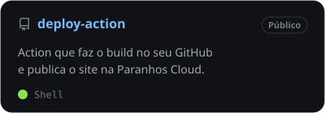
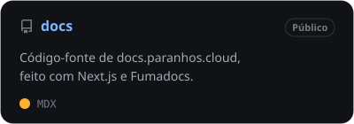

<div align="center">

<a href="https://paranhos.cloud"></a>

<br />

<a href="https://app.paranhos.cloud/signup"></a>&nbsp;
<a href="https://docs.paranhos.cloud"><picture><source media="(prefers-color-scheme: light)" srcset="assets/btn-docs-light.svg" /></picture></a>&nbsp;
<a href="https://paranhos.cloud"><picture><source media="(prefers-color-scheme: light)" srcset="assets/btn-site-light.svg" /></picture></a>&nbsp;
<a href="https://status.paranhos.cloud"><picture><source media="(prefers-color-scheme: light)" srcset="assets/btn-status-light.svg" /></picture></a>

<br /><br />

<picture>
  <source media="(prefers-color-scheme: light)" srcset="assets/how-light.svg" />
  
</picture>

</div>

<br />

Um pull request adiciona o workflow ao seu repositório. Depois disso, cada push na `main` faz o build no seu próprio GitHub Actions e só a pasta final sobe para a Paranhos Cloud:

```yaml
permissions:
  contents: read
  id-token: write   # GitHub OIDC: nenhum segredo guardado no repositório

steps:
  - uses: actions/checkout@v7
  - uses: paranhos-cloud/deploy-action@v1
```

### Código aberto

<a href="https://github.com/paranhos-cloud/deploy-action"><picture><source media="(prefers-color-scheme: light)" srcset="assets/repo-deploy-action-light.svg" /></picture></a>
<a href="https://github.com/paranhos-cloud/docs"><picture><source media="(prefers-color-scheme: light)" srcset="assets/repo-docs-light.svg" /></picture></a>

<br />

<a href="https://paranhos.cloud"></a>
